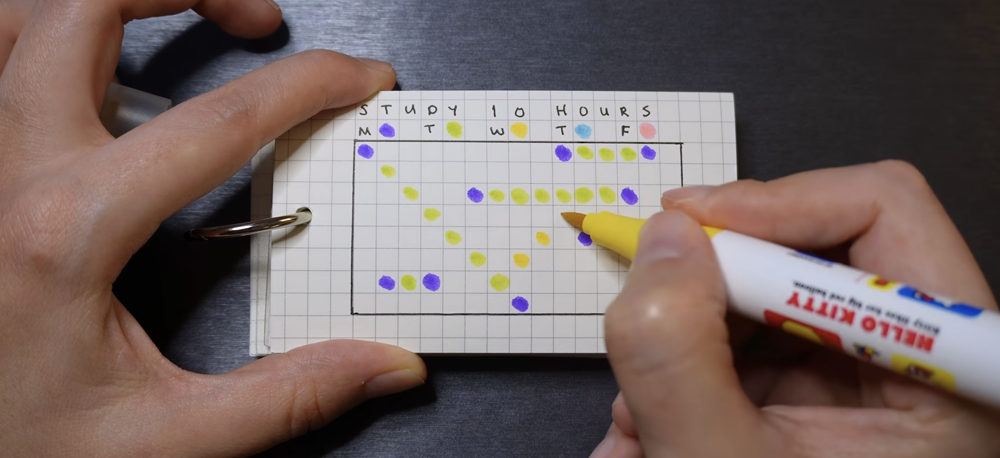

# ZiZi — Intuitive Goal Grid Tracker


A low-friction, visual motivation tracker designed to overcome task-initiation friction without the anxiety of rigid schedules or strict deadlines. Break big goals into bite-sized visual blocks and paint your progress as you go.

> *A motivation tracker, not a strict tracker app by definition. It helps with starting the task, easing the avoidance and similar dilemmas that delay our everyday lives through our own minds' foolishness. If you're tired of rigid time-management workflows that emphasize the feeling of being off-track or late—inducing anxiety about your progress—try this unrestricted tracker.*

Track target hours for projects/studying/reading using this interactive tracker by setting your desired slices of Pomodoro cubes ex. 25 mins sessions and total hours to complete each subject.

Here :

[](https://zizi-mu.vercel.app/)

------

##Stack:

[](https://zizi-mu.vercel.app/)




---

## Quick Start (User Guide)

1. **Set Your Goal:** Enter your target hours (e.g., `10 hrs`) and how much time each square represents (e.g., `5`, `15`, or `25 mins`). The grid dimensions auto-adjust to fit your goal.
2. **Pick Your Palette:** Label your colors by **day of the week** (Monday–Sunday) or by **project task/subject** using the color legend above the grid.
3. **Paint Your Progress:** Select an active color and click squares on the grid as you complete sessions. Your progress saves automatically in your browser (`localStorage`).

---

## Key Features

* **Dynamic Auto-Fit Grid:** Automatically calculates rows and columns from your total goal and time-slice unit.
* **Dual-Mode Color Legend:** Track consistency across days of the week or visualize time distribution across multiple tasks.
* **Zero-Setup Persistence:** Runs locally in the browser with automatic `localStorage` saving—no accounts or logins required.
* **Responsive Layout:** Fluid CSS Grid scaling across ultrawide monitors, laptops, and smaller viewports.

---

## Architecture & Roadmap

For the full mathematical breakdown of the Auto-Fit Calculator, component design, and upcoming features (like Strict Weaving Mode and PNG export), see the **[Technical Specifications](./specifications.md#intuitive-goal-grid-tracker)**.

---

## Local Development

```bash
git clone [https://github.com/Z3RG3/ZiZi.git](https://github.com/Z3RG3/ZiZi.git)
cd ZiZi
npm install
npm run dev
